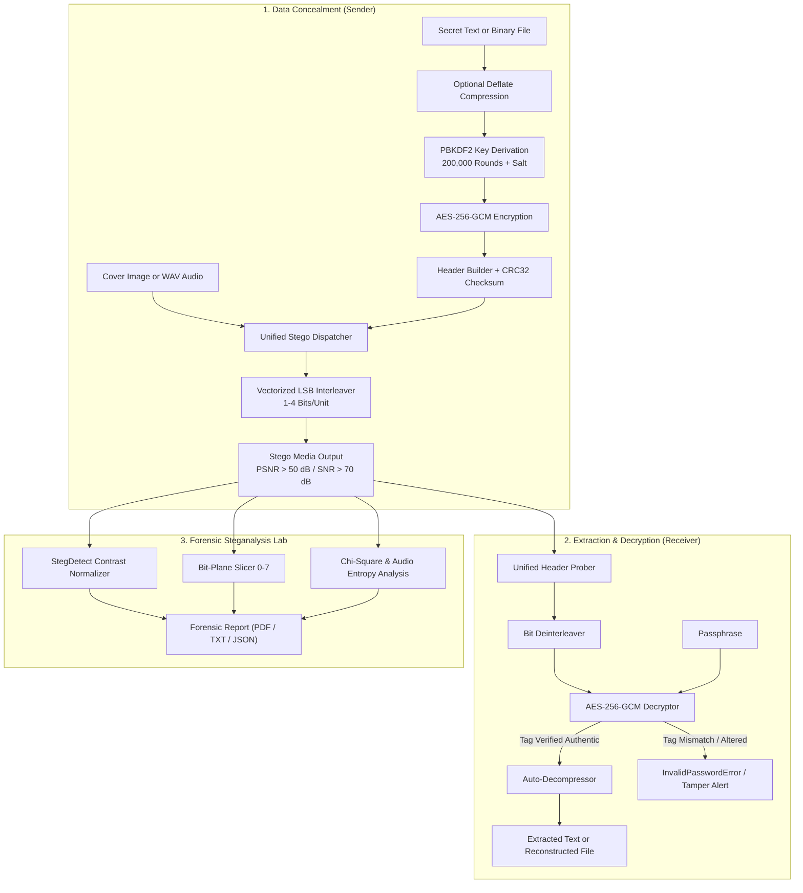

# CloakPix 🛡️ – Secure Image & Audio Steganography Suite

[](https://www.python.org/)
[](https://riverbankcomputing.com/software/pyqt/)
[](https://pycryptodome.readthedocs.io/)
[](demo_assets/)
[](https://github.com/ragibson/Steganography)
[-10b981?style=flat-square&logo=pytest&logoColor=white)](tests/)
[](LICENSE)
[](INSTALL.md)

**CloakPix** is an multi-media steganography application and digital forensics laboratory. It conceals encrypted text messages and arbitrary files (PDF, DOCX, ZIP, TXT, images, and binaries) inside lossless images (**PNG, BMP, TIFF, lossless WEBP**) and uncompressed PCM audio (**WAV 8/16/32-bit**) using vectorized Least Significant Bit (LSB) embedding, backed by **AES-256-GCM** authenticated encryption, **PBKDF2-HMAC-SHA256** key derivation (200,000 rounds), transparent zlib Deflate pre-compression, and a full digital forensics suite featuring **StegDetect** visual contrast normalization.

> 💡 **Reference & Lineage**: Inspired by and improving upon the classic [`ragibson/Steganography`](https://github.com/ragibson/Steganography) (`stego-lsb`, `WavSteg`, and `StegDetect`), CloakPix introduces military-grade authenticated encryption, automated multi-bit depth header probing, audio steganography with SNR acoustic verification, a modern dark PyQt6 desktop interface, and statistical steganalysis.

---

## 📑 Table of Contents

- [🌟 Key Highlights & Capabilities](#-key-highlights--capabilities)
- [📸 Demonstration Screenshots](#-demonstration-screenshots)
- [🏗️ System Architecture & Workflow](#️-system-architecture--workflow)
- [🚀 Quick Start & Installation](#-quick-start--installation)
- [🖥️ Desktop GUI Guide](#️-desktop-gui-guide)
- [💻 Command-Line Interface (CLI) Guide](#-command-line-interface-cli-guide)
  - [1. Hide Data (Image & Audio)](#1-hide-data-in-image-or-wav-audio)
  - [2. Extract & Decrypt Data](#2-extract-data-from-stego-image-or-wav-audio)
  - [3. StegDetect Visual Contrast Normalizer](#3-stegdetect-visual-contrast-normalizer)
  - [4. Forensic Steganalysis Lab](#4-forensic-steganalysis-image--audio)
  - [5. Carrier Capacity Checker](#5-carrier-capacity-checker)
  - [6. Bit Interleaving Speed Benchmark](#6-bit-manipulation-speed-benchmark)
- [🔐 Cryptographic Header Protocol Specification](#-cryptographic-header-protocol-specification)
- [📊 Steganographic Quality & Speed Benchmarks](#-steganographic-quality--speed-benchmarks)
- [🔬 Forensic Steganalysis Capabilities](#-forensic-steganalysis-capabilities)
- [📁 Repository Structure](#-repository-structure)
- [🧪 Automated Test Suite](#-automated-test-suite)
- [🚀 Preparing & Pushing to GitHub](#-preparing--pushing-to-github)
- [📄 License & Credits](#-license--credits)

---

## 🌟 Key Highlights & Capabilities

* **🔒 Military-Grade Cryptographic Security**:
  * AES-256 in Galois/Counter Mode (**AES-256-GCM**) provides both privacy and cryptographic authenticity.
  * Key derivation via **PBKDF2-HMAC-SHA256** with **200,000 iterations** and random 128-bit cryptographic salts.
  * Instant tamper detection: modifying any carrier bit or entering an incorrect passphrase fails GCM tag verification immediately.
* **🎵 Audio & Image Dual-Medium Steganography**:
  * **Images**: Lossless PNG, BMP, TIFF, and lossless WEBP carriers (RGB and RGBA).
  * **Audio**: Uncompressed PCM WAV files (8-bit, 16-bit, 32-bit, mono and stereo).
  * Ultra-high acoustic fidelity: Signal-to-Noise Ratio (**SNR > 70–110 dB**) for 1-bit LSB audio concealment.
  * Automated routing: the unified dispatcher automatically identifies media format and adapts encoding/decoding.
* **👁️ StegDetect Visual Contrast Normalizer**:
  * Directly inspired by `ragibson/Steganography`'s StegDetect tool.
  * Extracts the lowest $N$ LSBs (1 to 8) and normalizes the dynamic range across the full [0, 255] spectrum.
  * Instantly reveals hidden watermarks, steganographic noise patterns, and tampered bitplanes invisible to the naked eye.
* **🗜️ Transparent Pre-Compression (Deflate/zlib)**:
  * Optional pre-compression (`--compress` / `-z`) compresses text or binary payloads before encryption.
  * Significantly increases practical carrier capacity while reducing the required embedding footprint.
* **⚡ Vectorized Bit Engine & Benchmark Suite**:
  * High-performance bit interleaving and deinterleaving vectorized with NumPy.
  * Built-in benchmarking suite testing throughput across bit depths 1–8 (achieving > 60 MB/s decode speeds).
* **🔬 Advanced Forensic & Steganalysis Lab**:
  * **Visual Bit-Plane Slicer & StegDetect**: Real-time interactive inspection of bit planes 0–7 and amplified LSB contrast.
  * **Chi-Square ($\chi^2$) Steganalysis**: Pairs of Values (PoV) testing estimating steganographic detection probability.
  * **Shannon Entropy Analysis**: Multi-channel and LSB plane entropy calculation for both images and audio bitplanes.
  * **Sample Pair Analysis (SPA)**: Mathematical estimation of hidden message length.
  * **Audio Forensics**: Calculates bitplane Shannon entropy, RMS signal energy, and DC bias offset.
  * **Forensic Report Export**: Generate PDF, JSON, or plain text forensic dossiers with cryptographic hashes.
* **🎨 Modern Desktop GUI**:
  * Built with PyQt6 featuring a sleek dark theme, drag-and-drop zones for images and audio, live capacity gauges, and real-time audio waveform metadata.
* **💻 Complete Headless CLI**:
  * Comprehensive CLI with subcommands: `hide`, `extract`, `analyze`, `capacity`, `stegdetect`, and `benchmark`.

---

## 📸 Demonstration Screenshots

| 1. Hide Data View (Image & Audio) | 2. Embedding Quality Analysis |
| :---: | :---: |
|  |  |
| *Drag-and-drop carrier, payload selection, password strength gauge, and bit density selector.* | *Real-time fidelity metrics: PSNR, MSE, SSIM, and carrier capacity consumption.* |

| 3. Extract & Decrypt View | 4. Steganalysis & StegDetect Lab |
| :---: | :---: |
|  |  |
| *Automated carrier detection, multi-bit probing, password verification, and file exporter.* | *Interactive bit-plane slicer (0–7), StegDetect dynamic range normalizer, Chi-Square histogram.* |

| 5. Operation Audit Trail |
| :---: |
|  |
| *Persistent cryptographic ledger recording all concealments, extractions, and forensic scans.* |

---

## 🏗️ System Architecture & Workflow



---

## 🚀 Quick Start & Installation

### 1. Prerequisites
* **Python**: Python 3.10, 3.11, or 3.12+
* **Platforms**: Windows 10/11, macOS 12+, or Linux (Ubuntu 20.04+, Debian, Fedora, Arch)

### 2. Clone the Repository
```bash
git clone https://github.com/<your-username>/cloakpix.git
cd cloakpix
```

### 3. Set Up Virtual Environment (Recommended)

* **Windows (PowerShell)**:
  ```powershell
  python -m venv venv
  .\venv\Scripts\Activate.ps1
  ```
* **macOS / Linux (Bash / Zsh)**:
  ```bash
  python3 -m venv venv
  source venv/bin/activate
  ```

### 4. Install Dependencies
```bash
pip install -r requirements.txt
```

### 5. Launch Desktop GUI
```bash
python main.py
```

### 6. Run Automated Test Suite
```bash
python -m pytest tests/ -v
```

---

## 🖥️ Desktop GUI Guide

To start the graphical interface, run:
```bash
python main.py
```
or explicitly:
```bash
python -m cloakpix.app
```

The GUI consists of five integrated panels:
1. **Hide Data (Concealment View)**:
   - Drag and drop lossless images (`.png`, `.bmp`, `.tiff`, `.webp`) or uncompressed audio (`.wav`).
   - Select either **Secret Text** or attach an arbitrary **Binary File** (PDF, ZIP, DOCX, etc.).
   - Choose embedding density (1, 2, 3, or 4 bits per channel/sample).
   - Toggle **Pre-Compression** for Deflate compression before encryption.
   - Enter your passphrase; a live zxcvbn-style entropy gauge rates passphrase strength.
2. **Extract & Decrypt View**:
   - Drop the steganogram into the target container.
   - Enter the passphrase. CloakPix's **Unified Header Prober** scans across bit depths automatically.
   - Verified text messages are rendered in-app; binary files can be exported to your disk with their preserved original filenames.
3. **Forensic Steganalysis Lab**:
   - Interactive **Bit-Plane Slicer**: Inspect bit planes 0 through 7 across Red, Green, Blue, Grayscale, or combined channels.
   - **StegDetect Visual Normalizer**: Amplify the lowest $N$ LSBs across [0, 255] to visually expose embedded data boundaries.
   - **Statistical Steganalysis**: Run Chi-Square ($\chi^2$) analysis and Shannon entropy calculations.
   - **Dossier Export**: Export complete forensic findings to PDF, JSON, or plain text.
4. **Audit History Log**:
   - Searchable, timestamped record of every steganographic and forensic operation performed.
5. **Quality & Throughput Benchmarking**:
   - Inspect empirical PSNR, SSIM, and SNR ratings or benchmark local bit interleaving rates.

---

## 💻 Command-Line Interface (CLI) Guide

CloakPix provides a headless CLI ideal for automation, scripting, and remote servers.

### Display Help & Subcommands
```bash
python main.py --help
```

### 1. Hide Data in Image or WAV Audio

* **Hide Secret Text in a Lossless Image (1-bit LSB)**:
  ```bash
  python main.py hide --carrier demo_assets/carrier_cyber_landscape.png --text "Top Secret Rendezvous" --password "MasterKey#2026!" --output stego_image.png --bits 1
  ```

* **Hide a Binary File with Deflate Pre-Compression**:
  ```bash
  python main.py hide --carrier demo_assets/carrier_gradient_1200x800.png --file demo_assets/confidential_briefing.pdf --password "MasterKey#2026!" --output stego_pdf.png --compress
  ```

* **Hide Secret Intel into a Stereo WAV Audio File**:
  ```bash
  python main.py hide --carrier demo_assets/carrier_audio_stereo_44k.wav --text "Classified Acoustic Intel" --password "AudioPass#2026!" --output stego_audio.wav --bits 1
  ```

### 2. Extract Data from Stego Image or WAV Audio

* **Extract Text Message from Image**:
  ```bash
  python main.py extract --stego stego_image.png --password "MasterKey#2026!"
  ```

* **Extract Payload from WAV Audio**:
  ```bash
  python main.py extract --stego stego_audio.wav --password "AudioPass#2026!"
  ```

* **Extract Binary File to a Directory**:
  ```bash
  python main.py extract --stego stego_pdf.png --password "MasterKey#2026!" --output-dir ./extracted_files/
  ```

### 3. StegDetect Visual Contrast Normalizer

Directly inspired by `ragibson/Steganography`, this tool normalizes the dynamic range of the lowest $N$ LSBs:
```bash
python main.py stegdetect --image demo_assets/stego_demo.png --bits 2 --output stegdetect_contrast.png
```

### 4. Forensic Steganalysis (Image & Audio)

* **Analyze an Image and Export PDF & JSON Dossiers**:
  ```bash
  python main.py analyze --image stego_image.png --export-pdf forensic_report.pdf --export-json forensic_report.json
  ```

* **Extract a Specific Bit-Plane Slice (e.g. Bit 0, Combined Channel)**:
  ```bash
  python main.py analyze --image stego_image.png --slice-bit 0 --slice-channel combined --slice-out bit0_slice.png
  ```

* **Analyze a WAV Audio File and Export Plain Text**:
  ```bash
  python main.py analyze --target stego_audio.wav --export-txt audio_forensics.txt
  ```

### 5. Carrier Capacity Checker

Calculate maximum raw and usable capacity for images or audio:
```bash
python main.py capacity --carrier demo_assets/carrier_cyber_landscape.png --bits 1
python main.py capacity --carrier demo_assets/carrier_audio_stereo_44k.wav --bits 1
```

### 6. Bit Manipulation Speed Benchmark

Benchmark vectorized NumPy bit interleaving/deinterleaving throughput:
```bash
python main.py benchmark --payload 1.0 --carrier 10.0
```

---

## 🔐 Cryptographic Header Protocol Specification

CloakPix embeds a structured, tamper-proof binary header preceding the encrypted ciphertext:

| Offset | Field | Length | Description |
| :--- | :--- | :--- | :--- |
| `0x00` | `MAGIC_HEADER` | 7 bytes | Magic signature ASCII `CLOAKPX` |
| `0x07` | `VERSION` | 1 byte | Protocol version (`0x01`) |
| `0x08` | `PAYLOAD_TYPE` | 1 byte | `0x01` = Text, `0x02` = Binary File |
| `0x09` | `BITS_PER_CHANNEL` | 1 byte | Configured LSB bits (1 to 4) |
| `0x0A` | `FILENAME_LEN` | 2 bytes | Filename byte length ($N$) |
| `0x0C` | `FILENAME_BYTES` | $N$ bytes | UTF-8 encoded original filename |
| `0x0C + N` | `PAYLOAD_LEN` | 8 bytes | Length in bytes of encrypted ciphertext ($L$) |
| `0x14 + N` | `SALT` | 16 bytes | Random 128-bit PBKDF2 salt |
| `0x24 + N` | `NONCE` | 12 bytes | Random 96-bit AES-GCM IV |
| `0x30 + N` | `AUTH_TAG` | 16 bytes | AES-GCM authentication GMAC tag |
| `0x40 + N` | `HEADER_CRC32` | 4 bytes | CRC32 checksum over preceding header bytes |
| `0x44 + N` | `CIPHERTEXT` | $L$ bytes | AES-256-GCM encrypted payload ciphertext |

### Cryptographic Security Properties
1. **Authenticated Encryption (AEAD)**: The GMAC authentication tag guarantees that neither the header metadata nor the encrypted ciphertext can be modified without instant detection.
2. **Brute-Force Resistance**: 200,000 rounds of PBKDF2-HMAC-SHA256 mitigate GPU-accelerated dictionary attacks.
3. **Replay & Collision Protection**: Every embedding uses fresh 128-bit salts and 96-bit nonces generated via cryptographically secure pseudorandom number generators (`os.urandom`).

---

## 📊 Steganographic Quality & Speed Benchmarks

### 1. Carrier Quality Benchmarks
| Carrier Medium | Format | Embedding Density | Embedded Size | Quality Metric | Human Perception |
| :--- | :---: | :---: | :---: | :---: | :---: |
| Cyber Landscape (800×600) | PNG | 1 Bit / Channel | 10.4 KB | **PSNR: 58.74 dB** (SSIM: 0.9999) | Imperceptible |
| Cyber Landscape (800×600) | PNG | 2 Bits / Channel | 20.8 KB | **PSNR: 44.21 dB** (SSIM: 0.9987) | Imperceptible |
| Geometric Gradient (1200×800) | BMP | 1 Bit / Channel | 45.2 KB | **PSNR: 59.12 dB** (SSIM: 0.9999) | Imperceptible |
| Geometric Gradient (1200×800) | TIFF | 3 Bits / Channel | 135.0 KB | **PSNR: 38.45 dB** (SSIM: 0.9912) | Near Imperceptible |
| Synthetic Stereo Audio (44.1k) | WAV | 1 Bit / Sample | 4.2 KB | **SNR: 108.67 dB** | Imperceptible |
| Synthetic Mono Audio (22k) | WAV | 2 Bits / Sample | 2.1 KB | **SNR: 65.42 dB** | Imperceptible |

### 2. Bit Interleaving Engine Throughput
| # LSBs | Interleave Encode Rate | Deinterleave Decode Rate | Status |
| :---: | :---: | :---: | :---: |
| **1 LSB** | 25.3 MB/s | **62.4 MB/s** | 100% Verified Match |
| **2 LSBs** | 10.6 MB/s | **51.3 MB/s** | 100% Verified Match |
| **3 LSBs** | 15.0 MB/s | **50.0 MB/s** | 100% Verified Match |
| **4 LSBs** | 18.1 MB/s | **62.4 MB/s** | 100% Verified Match |
| **6 LSBs** | 25.0 MB/s | **64.5 MB/s** | 100% Verified Match |
| **8 LSBs** | 27.8 MB/s | **62.5 MB/s** | 100% Verified Match |

---

## 🔬 Forensic Steganalysis Capabilities

* **StegDetect Dynamic Range Normalizer**:
  $$P'_{\text{stegdetect}} = (P \ \& \ (2^k - 1)) \times \frac{255}{2^k - 1}$$
  Isolates the lowest $k$ LSBs and maps them across the full 8-bit dynamic range $[0, 255]$, transforming subtle embedding patterns into visible high-contrast artifacts.
* **Chi-Square ($\chi^2$) Analysis**:
  Evaluates Pairs of Values (PoVs) between adjacent even and odd pixel frequencies ($2k, 2k+1$). In clean natural images, odd/even counts differ naturally; in pseudorandom LSB steganograms, frequencies equalize towards 50%.
* **Shannon Entropy**:
  Calculates bit-level entropy ($H \in [0, 8]$) across individual channels and isolated LSB planes. Natural LSB planes exhibit entropy well below 1.0 bit/symbol, whereas encrypted payloads approach maximum entropy ($\approx 1.0$).
* **Sample Pair Analysis (SPA)**:
  Estimates the embedded payload length by modeling transitions between contiguous sample pairs.
* **Audio Forensics**:
  Calculates sample bitplane Shannon entropy, RMS signal power, and DC bias shift to detect acoustic anomalies.

---

## 📁 Repository Structure

```
steganography-tool/
├── cloakpix/                   # Core application package
│   ├── app.py                  # PyQt6 GUI bootstrap and application runner
│   ├── cli.py                  # Headless Command-Line Interface router
│   ├── core/                   # Cryptography, stego engines, and forensics
│   │   ├── audio_forensics.py  # Audio bitplane entropy, RMS, DC offset
│   │   ├── audio_stego.py      # WAV PCM LSB embedding, extraction, SNR
│   │   ├── bit_engine.py       # Vectorized NumPy bit interleaver & benchmark
│   │   ├── crypto.py           # AES-256-GCM, PBKDF2-HMAC-SHA256, verification
│   │   ├── exceptions.py       # Custom exception hierarchy
│   │   ├── file_manager.py     # Lossless file I/O & JSON audit trail
│   │   ├── forensics.py        # StegDetect, Chi-Square, Shannon entropy, PDF
│   │   ├── metrics.py          # PSNR, MSE, SSIM, SNR, capacity calculations
│   │   ├── stego_engine.py     # Image LSB multi-bit engine & header builder
│   │   └── unified_engine.py   # Unified router for Image and Audio media
│   └── gui/                    # Modern Dark PyQt6 desktop interface
│       ├── components/         # Drop zones, password boxes, metrics displays
│       ├── main_window.py      # Primary window with tab management
│       ├── styles.py           # Curated dark stylesheet & color palette
│       └── views/              # Encode, Decode, Forensics, Audit views
├── demo_assets/                # Ready-to-use sample carriers and payloads
│   ├── carrier_cyber_landscape.png
│   ├── carrier_gradient_1200x800.png
│   ├── carrier_audio_stereo_44k.wav
│   ├── carrier_audio_mono_8bit.wav
│   ├── confidential_briefing.pdf
│   └── secret_intel_message.txt
├── docs/                       # Documentation and media
│   └── screenshots/            # Demonstration screenshots for README
├── tests/                      # Automated test suite (43 unit & integration tests)
│   ├── test_audio_forensics.py
│   ├── test_audio_stego.py
│   ├── test_cli.py
│   ├── test_crypto.py
│   ├── test_file_manager.py
│   ├── test_forensics.py
│   ├── test_gui.py
│   ├── test_stegdetect.py
│   ├── test_stego_engine.py
│   └── test_unified_engine.py
├── create_screenshots.py       # Automated GUI screenshot generator
├── generate_demo_assets.py     # Sample asset generation script
├── INSTALL.md                  # Comprehensive platform installation guide
├── LICENSE                     # MIT Open Source License
├── main.py                     # Root executable launcher (GUI + CLI)
├── README.md                   # This project documentation
├── REPORT.md                   # Full technical report & steganographic study
└── requirements.txt            # Python package dependencies
```

---

## 🧪 Automated Test Suite

CloakPix maintains rigorous test coverage with **43 tests** across 10 modules:

```bash
python -m pytest tests/ -v
```

### Coverage Breakdown:
* **Audio Steganography Engine** (`test_audio_stego.py`): 8-bit/16-bit WAV embedding, extraction, SNR verification, wrong password rejection, tamper detection, capacity overflow.
* **Audio Forensics** (`test_audio_forensics.py`): Bitplane Shannon entropy, RMS energy, DC bias, TXT/JSON dossier export.
* **StegDetect & Bit Engine** (`test_stegdetect.py`): Dynamic range normalization (1–8 LSBs), vectorized bit interleaving, roundtrip validation.
* **Unified Stego Engine** (`test_unified_engine.py`): Automatic carrier dispatch (Image vs. WAV), transparent Deflate pre-compression.
* **Image LSB Engine** (`test_stego_engine.py`): Multi-bit embedding (1–4), RGBA alpha channel preservation, capacity boundary checks.
* **Cryptographic Suite** (`test_crypto.py`): AES-256-GCM roundtrip, PBKDF2 derivation, authentication failure on corrupted ciphertext.
* **Forensic Steganalysis** (`test_forensics.py`): Bit-plane slicing, Chi-Square PoV, Shannon entropy, PDF/JSON export.
* **GUI, CLI & File Manager** (`test_gui.py`, `test_cli.py`, `test_file_manager.py`): PyQt6 widgets, background workers, CLI subcommands, persistent audit logs.

**Result: 43 passed in ~9.7 seconds (100% pass rate).**

---

## 🚀 Preparing & Pushing to GitHub

To push this repository to GitHub:

### 1. Initialize & Verify Git Status
```bash
git status
```

### 2. Commit All Changes
```bash
git add .
git commit -m "docs: finalize enterprise README and GitHub release preparation"
```

### 3. Link Remote Repository & Push
Create a new repository on [GitHub](https://github.com/new) (e.g. `cloakpix`), then run:
```bash
git remote add origin https://github.com/<your-username>/cloakpix.git
git branch -M main
git push -u origin main
```

---

## 📄 License & Credits

* **License**: Distributed under the [MIT License](LICENSE).
* **Reference & Lineage**: Incorporates concepts inspired by [ragibson/Steganography](https://github.com/ragibson/Steganography) (`stego-lsb`, `WavSteg`, and `StegDetect`) under MIT License.
* **Authors**: CloakPix Engineering Team (2026).
